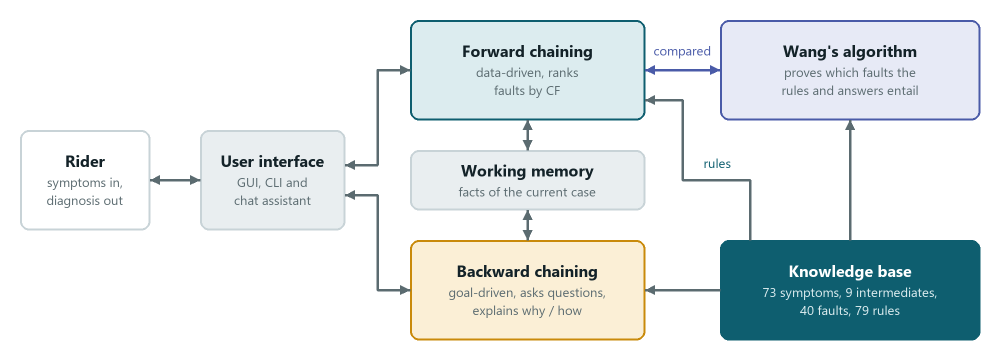
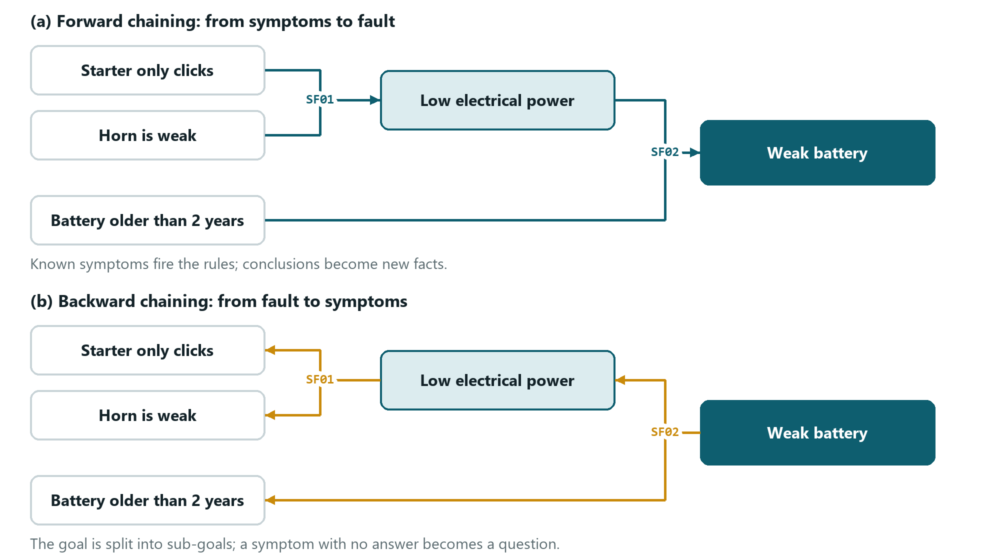

# Introduction and Background

Author: Tang Thoai Lam. Final draft, 12/11/2026, cut to the page budget in README.md (Chapter 1 about 170 words, Chapter 2 about 250 words).
Numbers refer to the knowledge base of 12/11/2026 (73 symptoms, 9 intermediate facts, 40 faults, 79 rules).

## Chapter 1: Introduction

### 1.1 Problem and goals

Viet Nam has about 74 million motorcycles, more than it has adults [WHO 2024]. When one breaks down, the rider must decide what to do with little to go on: a clicking starter with a weak horn usually needs only a battery charge, while leaking brake fluid means the motorbike should not be ridden.

We built a rule-based expert system for common faults on scooters and manual motorbikes. Its knowledge base has 73 symptoms, 9 intermediate facts, 40 faults and 79 rules in six subsystems. From the rider's symptoms it ranks the likely faults by certainty factor, says which need a mechanic and explains each conclusion. Forward chaining starts from ticked symptoms, backward chaining asks yes/no questions, and a rule-based chat reads the rider's own words. A prover based on Wang's algorithm checks the conclusions, and 30 test scenarios measure the results (Figure 1.1.1).

Figure 1.1.1: Overview of the system

### 1.2 Chapter conclusion

Symptom-based diagnosis suits a rule-based system that can explain its advice.

## Chapter 2: Background

### 2.1 Expert systems and certainty factors

A rule-based expert system keeps domain knowledge as IF ... THEN rules, and an inference engine applies them to the facts in working memory. MYCIN, a 1970s system for bacterial infections, attached to each rule a certainty factor (CF), an estimate of how strongly the premises support the conclusion, and could explain why it asked a question and how it reached a conclusion [Shortliffe and Buchanan 1975; Buchanan and Shortliffe 1984]. We use both ideas.

### 2.2 Forward and backward chaining

Our rules are definite clauses, for which entailment can be decided in linear time [Russell and Norvig 2020, ch. 7]. Forward chaining fires every rule whose premises are known until nothing new can be derived; backward chaining works back from a goal, so the program can ask for one fact at a time (Figure 2.2.1).

Figure 2.2.1: Forward and backward chaining on rules SF01 and SF02

### 2.3 Wang's algorithm

Wang's algorithm decides whether a propositional sequent is valid by removing one connective at a time until only atoms remain [Wang 1960]. Whether the rules and the answers entail a fault is such a sequent, and the prover shares no code with our engines, so a disagreement reveals a bug.

### 2.4 Related work

Aditya et al. [2022] used forward chaining in a mobile application for automatic motorcycles, and Anggrawan et al. [2026] compared certainty factors with case-based reasoning. We run both chaining directions on one knowledge base and add explanations and an independent proof check.

### 2.5 Chapter conclusion

Chapter 3 applies these techniques to our knowledge base.

## References

- Aditya, M. N., Delimayanti, M. K., Musyono, A. D. N. I., Kriswanto, Naryanto, R. F., and Sukoco, I. (2022). Development of a mobile expert system for the diagnosis on motorcycle damage using forward chaining algorithm. Indonesian Journal of Electrical Engineering and Computer Science, 27(3), 1601-1609. https://doi.org/10.11591/ijeecs.v27.i3.pp1601-1609
- Anggrawan, A., Satria, C., Triwijoyo, B. K., Priyanto, D., Hasbullah, H., and Rebecca, V. C. (2026). Expert system for motorcycle damage diagnosis using certainty factor and case-based reasoning methods. International Journal of Informatics and Communication Technology, 15(4), 1829-1840. https://doi.org/10.11591/ijict.v15i4.pp1829-1840
- Buchanan, B. G., and Shortliffe, E. H. (Eds.) (1984). Rule-Based Expert Systems: The MYCIN Experiments of the Stanford Heuristic Programming Project. Addison-Wesley.
- Russell, S., and Norvig, P. (2020). Artificial Intelligence: A Modern Approach (4th ed.). Pearson. Chapter 7, Logical Agents.
- Shortliffe, E. H., and Buchanan, B. G. (1975). A model of inexact reasoning in medicine. Mathematical Biosciences, 23(3-4), 351-379. https://doi.org/10.1016/0025-5564(75)90047-4
- Wang, H. (1960). Toward mechanical mathematics. IBM Journal of Research and Development, 4(1), 2-22.
- World Health Organization (2024, November 25). WHO convenes global motorcycle safety experts in Viet Nam. https://www.who.int/news/item/25-11-2024-who-convenes-global-motorcycle-safety-experts-in-viet-nam
